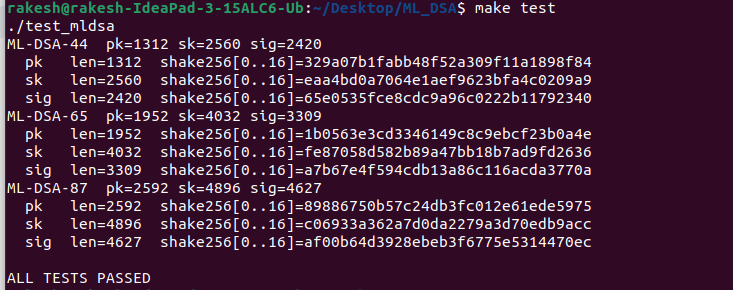
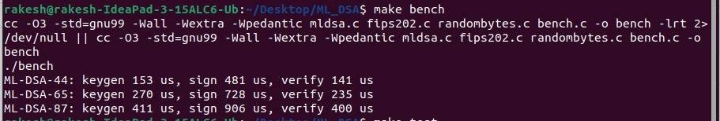

# ML-DSA in C (NIST FIPS 204)

A readable, spec-following C99/GNU99 implementation of **ML-DSA** (the Module-Lattice-Based Digital Signature Algorithm, formerly CRYSTALS-Dilithium), supporting **ML-DSA-44, ML-DSA-65 and ML-DSA-87**, selected at run time.


## What is implemented

| Feature | Status |
|---|---|
| KeyGen / Sign / Verify with context string (FIPS 204 Alg. 1-3) | Yes |
| `KeyGen_internal` / `Sign_internal` / `Verify_internal` (Alg. 6-8) | Yes |
| Hedged and deterministic signing | Yes |
| ML-DSA-44, -65, -87 | Yes |
| HashML-DSA (pre-hash, Alg. 4-5) | No |
| NIST ACVP vector tests | No |

## Files

| File | Purpose |
|---|---|
| `mldsa.h` | Public API, size macros, error codes |
| `mldsa.c` | ML-DSA implementation (NTT, rounding, sampling, packing, keygen, sign, verify) |
| `mldsa_zetas.h` | NTT table: `1753^brv8(i) mod q` (FIPS 204 Appendix B) |
| `fips202.h`, `fips202.c` | SHAKE128 / SHAKE256 (Keccak-f[1600]) |
| `randombytes.c` | OS randomness (`/dev/urandom`, or BCrypt on Windows) |
| `test_mldsa.c` | Test suite |
| `bench.c` | Benchmark |
| `Makefile` | Build targets |


## Command line

Requires a C compiler and `make`.

```bash
cd ML_DSA            # folder containing the files

make test            # build and run the test suite
make sanitize        # same tests with AddressSanitizer + UBSan
make bench           # build and run the benchmark
make clean           # remove binaries
```

Without `make`:

```bash
gcc -O3 mldsa.c fips202.c randombytes.c test_mldsa.c -o test_mldsa && ./test_mldsa
gcc -O3 mldsa.c fips202.c randombytes.c bench.c -o bench && ./bench
```


## Results

### Test suite (`make test`)

Run on Ubuntu (IdeaPad 3 15ALC6). Fixed seed, deterministic signing, so the digests below are reproducible on any correct build.

```
ML-DSA-44  pk=1312 sk=2560 sig=2420
  pk   len=1312  shake256[0..16]=329a07b1fabb48f52a309f11a1898f84
  sk   len=2560  shake256[0..16]=eaa4bd0a7064e1aef9623bfa4c0209a9
  sig  len=2420  shake256[0..16]=65e0535fce8cdc9a96c0222b11792340
ML-DSA-65  pk=1952 sk=4032 sig=3309
  pk   len=1952  shake256[0..16]=1b0563e3cd3346149c8c9ebcf23b0a4e
  sk   len=4032  shake256[0..16]=fe87058d582b89a47bb18b7ad9fd2636
  sig  len=3309  shake256[0..16]=a7b67e4f594cdb13a86c116acda3770a
ML-DSA-87  pk=2592 sk=4896 sig=4627
  pk   len=2592  shake256[0..16]=89886750b57c24db3fc012e61ede5975
  sk   len=4896  shake256[0..16]=c06933a362a7d0da2279a3d70edb9acc
  sig  len=4627  shake256[0..16]=af00b64d3928ebeb3f6775e5314470ec

ALL TESTS PASSED
```

### Benchmark (`make bench`)

Single core, `-O3`, plain C (no assembly or AVX2):

| Level | KeyGen | Sign | Verify |
|---|---|---|---|
| ML-DSA-44 | 153 us | 481 us | 141 us |
| ML-DSA-65 | 270 us | 728 us | 235 us |
| ML-DSA-87 | 411 us | 906 us | 400 us |

Timings vary between runs and machines.

### Sizes (bytes)

| Level | Public key | Secret key | Signature | NIST category |
|---|---|---|---|---|
| ML-DSA-44 | 1312 | 2560 | 2420 | 2 |
| ML-DSA-65 | 1952 | 4032 | 3309 | 3 |
| ML-DSA-87 | 2592 | 4896 | 4627 | 5 |

### Terminal output





## References

1. NIST FIPS 204, *Module-Lattice-Based Digital Signature Standard* (August 2024).
   https://csrc.nist.gov/pubs/fips/204/final
2. Claude (AI assistant), Anthropic. Used to write the initial C implementation and test suite.
   https://www.anthropic.com/claude
