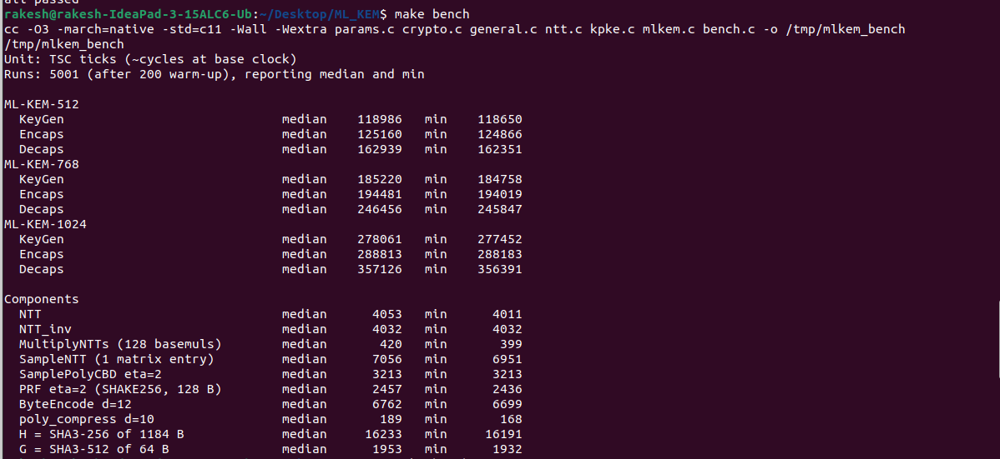
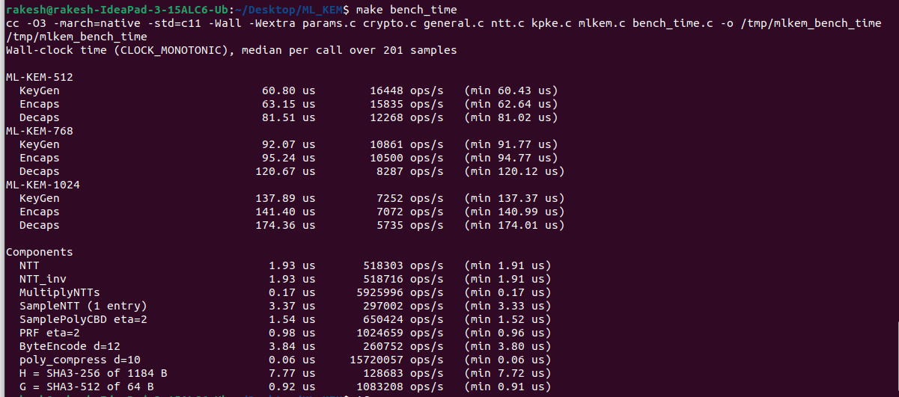

## Benchmark results

### Setup

| | |
|---|---|
| Machine | Lenovo IdeaPad 3 15ALC6 |
| CPU | AMD Ryzen 5 5500U with Radeon Graphics |
| OS | Ubuntu 22.04 (Linux) |
| Compiler / flags | GCC 11.4.0, `-O3 -march=native -std=c11` |
| CPU governor | `schedutil` (default dynamic frequency scaling, turbo not disabled) |
| Method | 200 warm-up runs; median of 5,001 runs (ticks) or 201 batched samples (time); single-threaded |

### KEM operations: wall-clock time

| | KeyGen | Encaps | Decaps |
|---|---|---|---|
| ML-KEM-512 | 60.80 µs (16,448 ops/s) | 63.15 µs (15,835 ops/s) | 81.51 µs (12,268 ops/s) |
| ML-KEM-768 | 92.07 µs (10,861 ops/s) | 95.24 µs (10,500 ops/s) | 120.67 µs (8,287 ops/s) |
| ML-KEM-1024 | 137.89 µs (7,252 ops/s) | 141.40 µs (7,072 ops/s) | 174.36 µs (5,735 ops/s) |

### KEM operations: TSC ticks (median)

| | KeyGen | Encaps | Decaps |
|---|---|---|---|
| ML-KEM-512 | 122,556 | 125,349 | 162,813 |
| ML-KEM-768 | 185,682 | 194,544 | 247,086 |
| ML-KEM-1024 | 278,544 | 288,561 | 359,394 |

### Components

| Component | Ticks (median) | Time (median) |
|---|---|---|
| `NTT` | 4,032 | 1.93 µs |
| `NTT_inv` | 4,032 | 1.93 µs |
| `MultiplyNTTs` (128 base multiplications) | 420 | 0.17 µs |
| `SampleNTT` (one matrix entry) | 7,077 | 3.37 µs |
| `SamplePolyCBD` (η = 2) | 3,213 | 1.54 µs |
| `PRF` (η = 2, SHAKE256) | 2,058 | 0.98 µs |
| `ByteEncode` (d = 12) | 6,741 | 3.84 µs |
| `poly_compress` (d = 10) | 168 | 0.06 µs |
| `H` = SHA3-256 of 1184 bytes | 16,212 | 7.77 µs |
| `G` = SHA3-512 of 64 bytes | 1,953 | 0.92 µs |

### Terminal output

`make bench` (TSC ticks):

`make bench_time` (wall-clock time):

